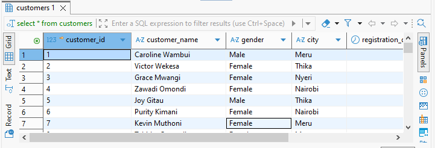
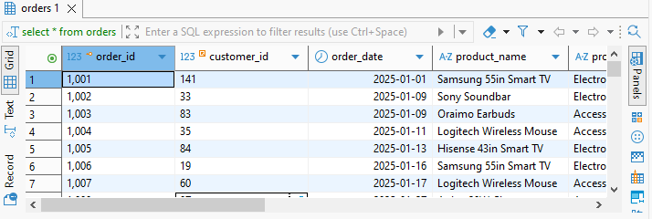
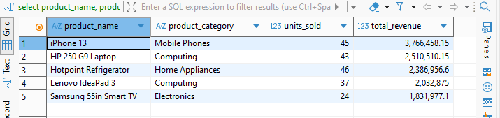
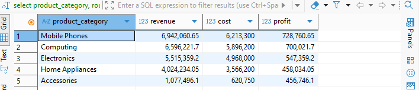
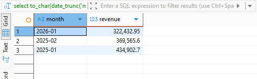
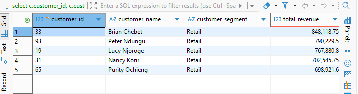
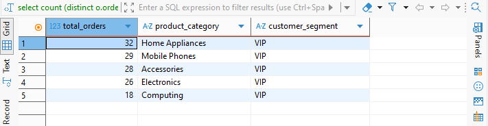
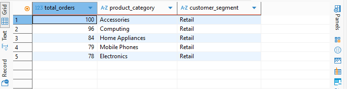

# Duka-Smart-SQL-Analysis
This project is an SQL analysis of a retail business's customer and order data in PostgreSQL, managed through DBeaver. It covers the full workflow, from creation of tables to producing management insights.
The project entailed:
## Data Preparation
Creating tables and inserting data into the tables.

Tables and indexes were created using the scripts below:
``` 
CREATE TABLE IF NOT EXISTS customers (
   ---
);
```

```

CREATE TABLE IF NOT EXISTS orders (
    ---
);
```

``
CREATE INDEX IF NOT EXISTS idx_orders_customer ON orders (customer_id);
``

``
CREATE INDEX IF NOT EXISTS idx_orders_date ON orders (order_date);
``

Subsequently, data was imported using the scripts below:

```
INSERT INTO customers (customer_id, customer_name, gender, city, registration_date, customer_segment) VALUES
---
ON CONFLICT (customer_id) DO NOTHING;
```

```
INSERT INTO orders (order_id, customer_id, order_date, product_name, product_category, quantity, unit_price, cost_price, discount, payment_method, order_status) VALUES
---
ON CONFLICT (order_id) DO NOTHING;
```
In the end, tables whose snippets are capatured below were arrived at.



## Analysis
Using joins, CTEs, subqueries and window functions (RANK, DENSE_RANK, ROW_NUMBER, LAG, NTILE) to measure revenue, cost, profit and margin. This includes customer spending by segment, the most popular categories, top customers and products, customer value segmentation, and month-over-month growth. 

In general, table creation and analysis was done using a stepwise approach shown by these [scripts](duka-smart-analysis.sql). 

## Outcome
Turning raw numbers into business insights.

The analysis yielded a range of insights.

*Best performing products by revenue:*
1. iPhone 13
2. HP 250 G9 Laptop
3. Hotpoint Refrigerator
4. Lenovo IdeaPad 3
5. Samsung 55-inch Smart TV
 


*Most Profitable categories:*
1. Mobile Phones
2. Computing
3. Electronics
4. Home Appliances
5. Accessories



*Lowest Revenue Months*
1. Jan 2026
2. Feb 2025
3. Jan 2025



The analysis showed that lowest revenue months are January and February. The business can try strategies such as enhanced discounts to attract more customers and improve on the revenue. Arguably, customers' purchasing power might be at the lowest in January and February. As such, lowering product prices might incetivize more people. 

*Top 5 customers by Revenue*

1. Brian Chebet
2. Peter Ndungu
3. Lucy Njoroge
4. Nancy Korir
5. Purity Ochieng



Interestingly, all top customers belonged to the retail tier. It is therefore clear that retail category of customers is as equally important to the business as any other segment. 

*Product Popularity Per Customer Segment*
The analysis showed that product popularity varied from one customer segment to the next. For example, top 5 popular products for the VIP customers were:

1. Home Appliances
2. Mobile Phones
3. Accessories
4. Electronics
5. Computing



On the other hand, top 5 popular products among the retail segment were:

1. Accessories
2. Computing
3. Home Appliances
4. Mobile Phones
5. Electronics



Varying product popularity for different customer segments calls for tailored marketing and advertising.

## Conclusion

Overall, the analysis highlighted how the business was performing with regards to revenue, profits, and costs. It also provided insights that can help the business make informed decisions with regards to marketing, pricing, and customer retention.  


